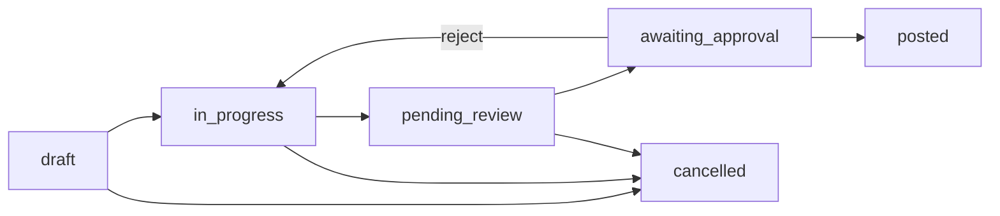

# Physical Stock Count — Review, Approve, As-Of (Design)

**Status:** Approved direction (owner chose **historical as-of**, option 1)  
**Date:** 2026-10-14  
**Locks:** Additive schema/RPC only. No DROP of money tables. Stock/GL write moves from “post” to “approve”.

## Problem

Today `post_stock_count_session` immediately inserts `stock_movements` (and GL via `post_stock_adjustment_to_accounting`). There is no variance dashboard gate, no final approval before stock changes, no `as_of` closing date, and no document number (`STK-…`).

## Locked decisions

| Topic | Decision |
|-------|----------|
| As-of meaning | **Historical stock.** Baseline = sum of movements with `created_at <= end of as_of_date (UTC day)`. Variance = physical − that baseline. Approved adjustments are stamped with `created_at` / JE `entry_date` on that as-of day. |
| Stock write | Only on **Approve**. Submit/Post does **not** write stock or GL. |
| Document number | One session number via ERP engine `get_next_document_number(…, 'stock')` → prefix **STK**, assigned on approve. |
| CoA | Unchanged path: adjustment movement → trigger Dr/Cr **1200** Inventory vs expense contra. JE still `stock_adjustment` on movement id; session carries human `document_no`. |
| STOCK CHANGED badge | Mid-count only: compares **live now** to `live_qty_at_capture` (set on add/recount). Never compares live to as-of baseline (that would false-badge every historical count). |
| All-branches find | Search shows summed “Current Stock (all branches)”. Qty dialog requires a **branch pick**; increment applies to that branch line only. |
| Cancel vs reverse | Non-posted → soft `cancelled`. Posted → `reverse_stock_count_session` (opposite `stock_count_reversal` movements + GL; keep STK `document_no`; status `reversed`). No hard delete. |
| Recent sessions list | Default excludes `cancelled` / `reversed`. “Show archived” reveals them. Create/cancel never write stock or GL. |
| Overage / shortage | Soft UI only: Over +X — recheck (amber); Short −X (rose). Never blocks submit/approve. |

## Status machine

| Status | Meaning | Stock? |
|--------|---------|--------|
| `draft` / `in_progress` | Counting | No |
| `pending_review` | Count complete — review dashboard / print | No |
| `awaiting_approval` | Submitted; qty locked | No |
| `posted` | Approved; movements + doc no | **Yes** |
| `cancelled` | Abandoned | No |

## RPC contract

| RPC | Behavior |
|-----|----------|
| `create_stock_count_session(..., p_as_of_date date)` | Stores `as_of_date` (default `CURRENT_DATE`). |
| `_stock_count_system_qty(..., p_as_of timestamptz)` | Optional cutoff; null = all movements (legacy live). |
| `stock_count_add_line` / recount | Baseline via as-of cutoff from session. |
| `complete_stock_count_session` | → `pending_review`; freezes line `variance`. |
| `post_stock_count_session` | → `awaiting_approval` only. **No** `stock_movements`. Idempotent if already awaiting/posted. |
| `approve_stock_count_session` | Requires `awaiting_approval`. Assigns `document_no`, inserts movements with as-of timestamp, → `posted`. |
| `reject_stock_count_session` | `awaiting_approval` → `in_progress` (re-open count). |

Permissions: submit/approve keep `inventory.post_count` / `inventory.adjust` / owner-admin (same gate as today’s post).

## UI (mobile + web)

1. **Start count:** date picker for as-of / closing date (e.g. 30 Sep).  
2. **Review & submit:** variance dashboard (per line: system as-of, physical, difference; totals over/short) + print. Confirm → `post` (awaiting approval).  
3. **Approve:** second screen on awaiting sessions — show same summary + document preview → Approve updates stock; Reject reopens.

## Out of scope (this wave)

- New dedicated shrinkage CoA code (keep existing trigger account resolution).  
- Period-close hard block on backdated stock.  
- Changing JE `entry_no` from `ADJ-…` to `STK-…` (session `document_no` is the operator-facing number).  
- Production migrate/deploy without separate owner approval.
